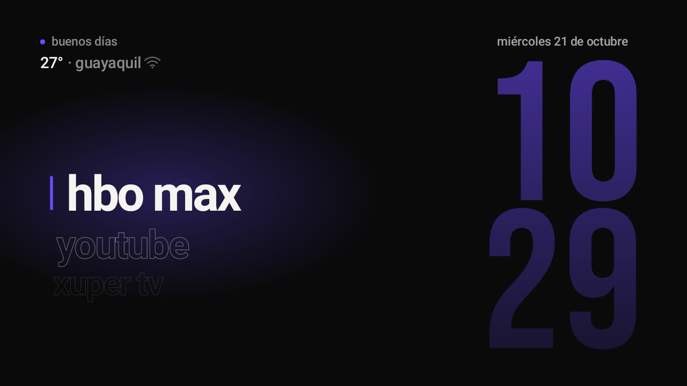
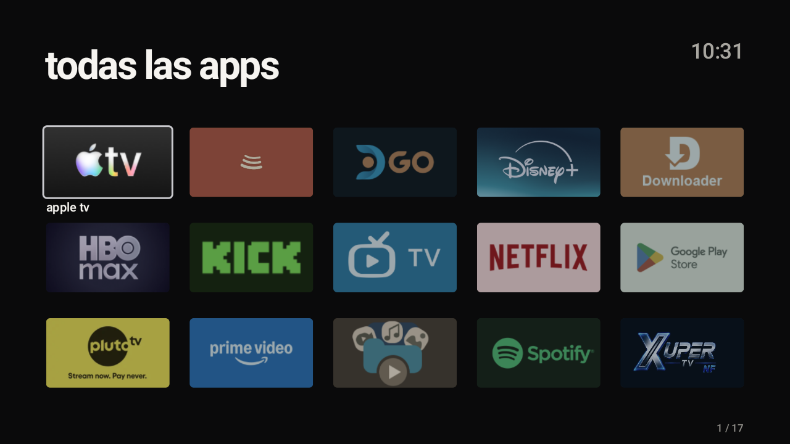
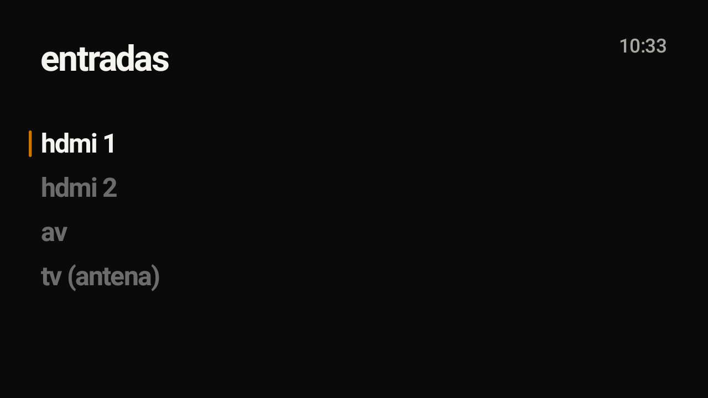
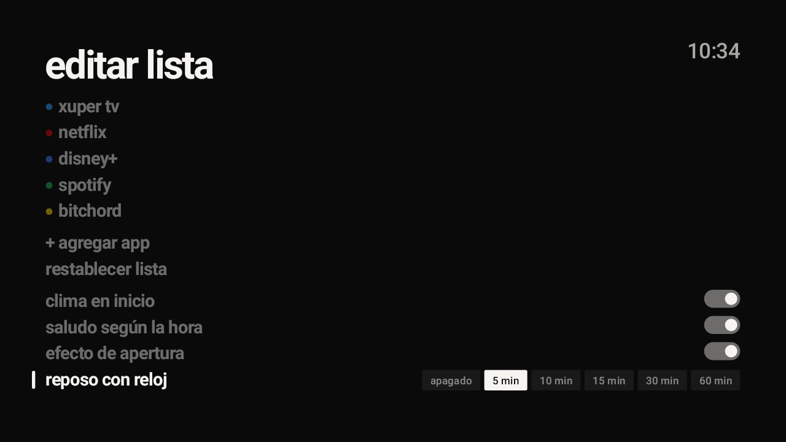
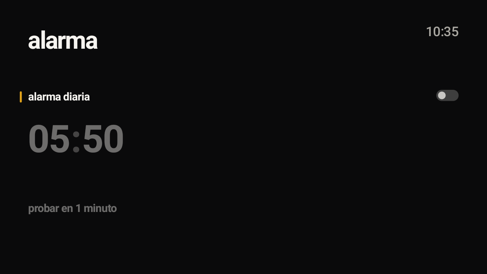
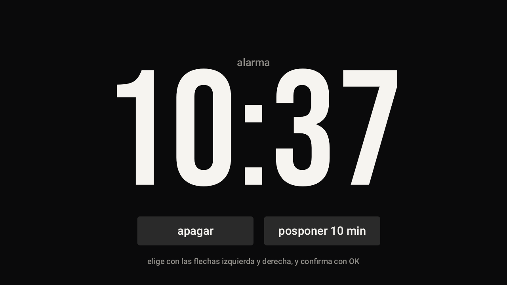
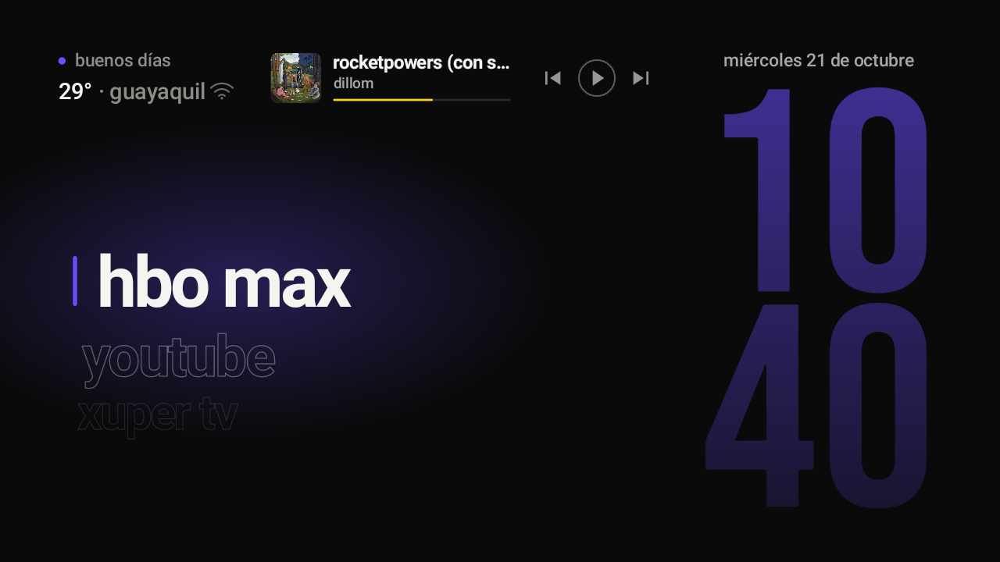
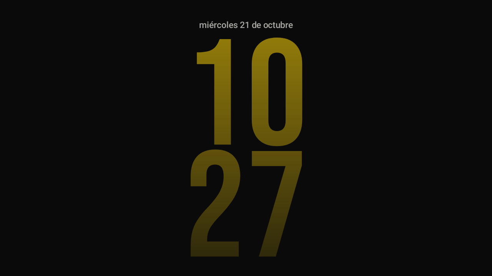
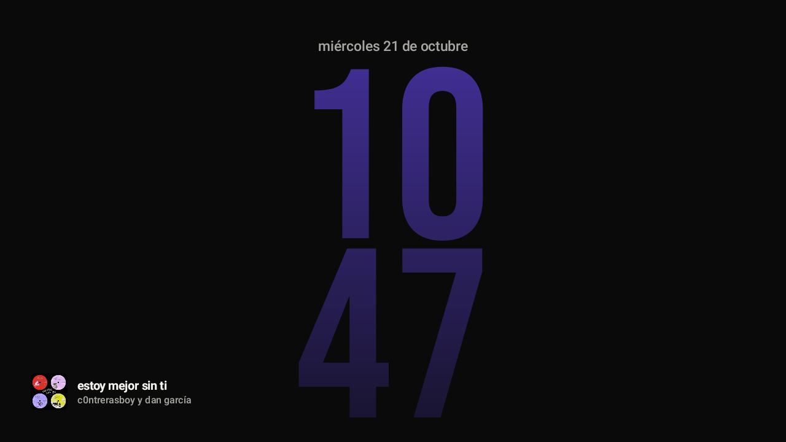

# TV Home Launcher

Una pantalla de inicio propia para un TV con Android: minimalista, tipográfica y rápida. Cada app es un
color de luz: al enfocar su nombre, el resplandor, la barra, el punto del saludo y el reloj gigante toman el
color de esa app. Incluye consola de música, reposo con reloj, alarmas y una lista que se edita desde el control remoto.

Hecho para un **Innova 32″ con Google TV (Android 11, 1,5 GB de RAM)** y pensado para repetirse en otros TVs.
Es un proyecto personal en versión 0.1.x (la última es la 0.1.33), todavía en pruebas.

## Capturas

Capturas reales del TV (1280×720), tomadas con la versión 0.1.26. La pantalla de alarmas cambió después (ahora son hasta 5 alarmas con días y etiqueta) y se actualizará en la próxima tanda de capturas.

| Inicio | Todas las apps | Entradas |
|---|---|---|
|  |  |  |

| Editar lista | Alarmas | Alarma sonando |
|---|---|---|
|  |  |  |

| Consola de música | Reposo con reloj | Reposo con música |
|---|---|---|
|  |  |  |

## Qué hace

- **Inicio:** una lista de apps en forma de rueda, con la seleccionada grande y las demás en contorno. Hora grande
  apilada (Bebas Neue) que cambia de minuto con una transición suave, fecha, saludo según la hora y clima de Guayaquil.
  Atrás e Inicio vuelven siempre a la primera app.
- **Color por app:** colores de marca conocidos y, para el resto, el color dominante del icono.
- **Consola de música:** si una app (BitChord, Spotify, YouTube Music...) está reproduciendo, aparecen portada,
  título, artista, progreso y controles junto al saludo. OK sobre el bloque abre la app que suena. Se oculta a los 3 minutos en pausa.
- **Sonidos al navegar:** un tic muy suave al moverte por la lista de inicio; sube de tono y baja de volumen cuanto más rápido avanzas. Se apaga o enciende en Editar lista.
- **Reposo con reloj:** tras unos minutos sin tocar el control (apagado, 5, 10, 15, 30 o 60, se elige en Editar lista), la lista sale
  y el reloj se desliza al centro. Con música sonando, el reloj toma el color de la portada y aparecen portada, título y artista abajo a la izquierda.
  Cualquier tecla despierta sin ejecutar nada. El reloj se desplaza unos píxeles para no marcar el panel.
- **Alarmas:** hasta 5, con hora, días de la semana, etiqueta e interruptor propio. Usan la alarma nativa de Android
  (suenan aunque el launcher esté cerrado y se reprograman al reiniciar el TV). Suenan sobre otras apps, con el volumen
  subiendo poco a poco hasta un tope y restaurándose al terminar. Se apagan o se posponen 10 minutos con botones en pantalla.
  Si nadie responde, vuelven a sonar una vez y luego se rinden. Mientras hay una alarma cerca, el launcher mantiene el TV despierto.
- **Todas las apps:** cuadrícula con banner o logo.
- **Entradas:** HDMI 1, HDMI 2, AV y TV (antena).
- **Editar lista:** agregar, quitar, mover y restablecer apps del inicio; interruptores de clima, saludo, efecto de apertura y alarma; tiempo de reposo.
- **BitChord:** si está instalado, se agrega al final de la lista en amarillo (ver Créditos).
- **Ajustes:** el engranaje del control abre los ajustes nativos del TV.

## Control remoto

| Tecla | Qué hace |
|---|---|
| Flechas y OK | Moverse y elegir. En la fila inferior del inicio (se alcanza bajando más allá de la última app) están las herramientas. |
| Atrás | Primera app del inicio; dentro de una pantalla, vuelve. |
| Inicio | Primera app del inicio, desde cualquier app. |
| Engranaje | Ajustes del sistema. |
| Micrófono | El asistente de Google, como siempre. |

**No funcionan:** el botón Entradas y los botones de YouTube, Netflix, Prime Video y YouTube Music. Con el inicio de
Google TV desactivado, el servicio de Realtek los consume y no llegan a ninguna app (detalle y pruebas en [docs/RESUMEN.md](docs/RESUMEN.md)).
Esas funciones se usan desde la lista y la fila inferior del launcher.

## Qué incluye el repositorio

| Carpeta | Para qué sirve |
|---|---|
| `launcher/` | El launcher: app de Android en Java, sin librerías externas. Un solo lienzo dibujado a mano de 1920×1080. |
| `scripts/` | Pasos para Windows, sin permisos de administrador: verificar el PC, inventario, instalar, deshacer y cerrar la depuración. |
| `tools/` | Cliente de ADB en Python puro, desactivar y restaurar paquetes con registro para deshacer. Viene de [CleanYourTV](https://github.com/Gathin23/cleanyourtv) (MIT). |
| `examples/` | Listas de apps a desactivar de otros modelos, como punto de partida. De CleanYourTV. |
| `docs/` | [Resumen completo](docs/RESUMEN.md) (versiones, decisiones, problemas y pendientes) y [solución de problemas](docs/TROUBLESHOOTING.md). |
| `PROMPT.md` | Instrucciones para que Claude Code haga todo el proceso en el PC. |

## Cómo se instala

1. En el TV: Ajustes, Acerca de, pulsar 7 veces "Compilación"; luego Opciones de desarrollador y encender
   **Depuración USB** y **Depuración por red**. Anotar la IP del TV.
2. En un PC con Windows en la misma red Wi-Fi: `git clone` de este repositorio y abrir Claude Code en la carpeta.
3. Decirle: *"Ejecuta PROMPT.md. La IP del TV es 192.168.x.x"*.
4. Responder una sola confirmación (la lista de apps a desactivar) y, al final, pulsar Inicio en el control remoto.

Para actualizar: `scripts\get-apk.ps1` baja el último APK de [Releases](../../releases/latest) y
`scripts\install.ps1 -TvHost <IP> -StockLauncher none` lo instala encima del anterior.

**Hacerlo el inicio real:** en Android 11 el inicio de Google TV (`launcherx`) gana siempre sobre un launcher propio.
Por eso, para que el botón Inicio abra este launcher, se desactivan `launcherx` y `setupwraith` (solo usuario 0, reversible).
Costo: pierdes los botones Entradas y de apps del control. Todo está explicado en [docs/RESUMEN.md](docs/RESUMEN.md).

### Permisos opcionales por ADB (una sola vez)

| Permiso | Para qué |
|---|---|
| Servicio de accesibilidad `KeyService` | Capturar la tecla del engranaje del control. Solo filtra teclas. |
| Acceso a notificaciones `MediaListener` | Leer la sesión de música para la consola. No lee tus notificaciones. |
| `SYSTEM_ALERT_WINDOW` y lista blanca de batería | Que la alarma aparezca sobre otras apps y suene con el TV en reposo. |
| `WRITE_SETTINGS` y `WRITE_SECURE_SETTINGS` | Subir los tiempos de pantalla y reposo del TV solo cuando hay una alarma cerca (12 h o menos) y volver a 30 y 60 minutos después. |

La app solo usa internet para el clima (Open-Meteo).

## Cómo volver atrás

Todo es reversible: las apps se **desactivan**, no se desinstalan. `tools\restore.ps1` devuelve las apps,
`scripts\undo-launcher.ps1` devuelve el inicio original y `scripts\finish.ps1` cierra la depuración al terminar.

## Limitaciones conocidas

- Si apagas el TV con el botón de encendido, queda en suspensión (STR de Realtek) y la alarma no lo despierta; hay que dejarlo en el reposo del launcher.
- Entradas y los botones de apps del control no funcionan con el inicio de Google TV desactivado.
- No hay lector de pantalla (TalkBack): el lienzo se dibuja a mano.
- La ciudad del clima es fija (Guayaquil).

## El APK

Lo compila GitHub Actions en cada cambio de `launcher/` y lo publica en [Releases](../../releases/latest) como `tvhome.apk`.
No hace falta instalar Java ni el SDK de Android.

## Usarlo en otro TV

El launcher y el procedimiento son los mismos. Lo que cambia por TV es la lista de apps a desactivar, que
se arma con el inventario de ese modelo (`scripts\inventory.ps1`). Guarda la lista final en `examples/<modelo>/debloat.txt`.

## Créditos y licencia

- **Diseño y desarrollo:** Josué Prieto (`josuenrikee`), con Claude (Anthropic) como asistente de programación y diseño.
- **Herramientas de desactivación y ejemplos:** [CleanYourTV](https://github.com/Gathin23/cleanyourtv), de Gathin, licencia MIT (`tools/`, `examples/`, `docs/TROUBLESHOOTING.md`).
- **BitChord:** [BitChord](https://github.com/kushagrasinghx/BitChord), cliente de YouTube Music para TV de kushagrasinghx. No forma parte de este repositorio: es una app de terceros que se instala aparte; el launcher solo la reconoce y la pinta en amarillo.
- **Clima:** [Open-Meteo](https://open-meteo.com), datos bajo CC BY 4.0.
- **Tipografía del reloj:** Bebas Neue, © 2010 Dharma Type, SIL Open Font License 1.1 (`launcher/app/src/main/assets/fonts/OFL.txt`). El resto usa Roboto del sistema.
- Las marcas de las apps (YouTube, Netflix, HBO Max, Disney+, Spotify y demás) pertenecen a sus dueños; el launcher solo las abre.

El launcher, los scripts y el resto son de Josué Prieto, bajo licencia MIT.
